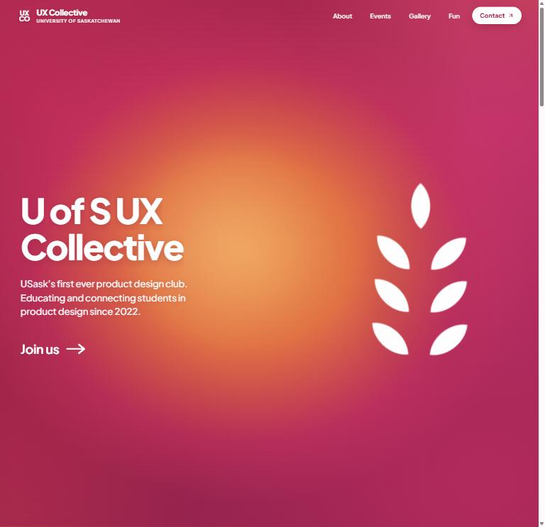
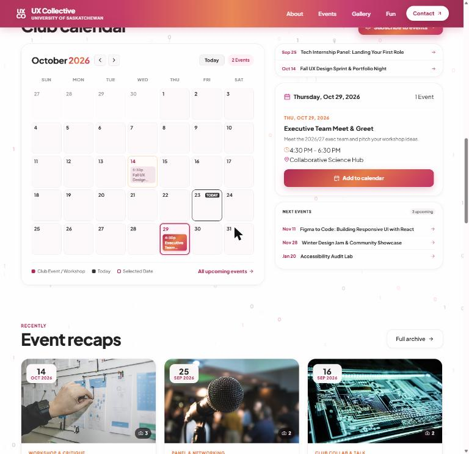
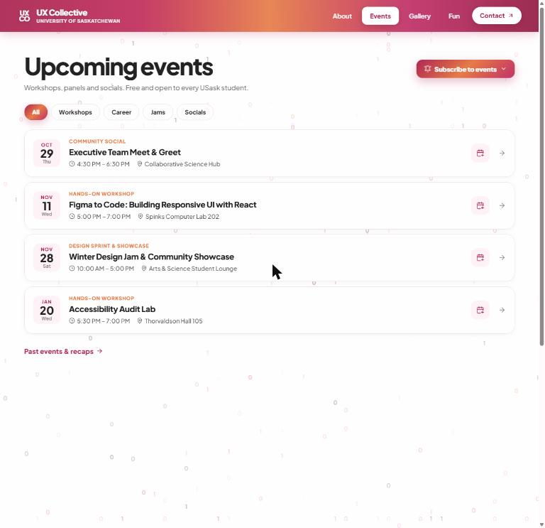
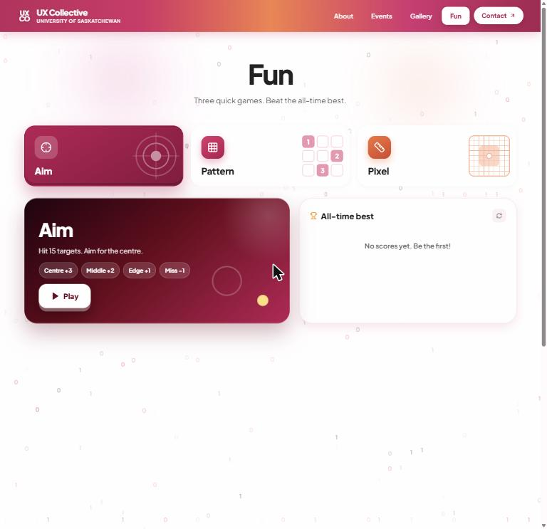
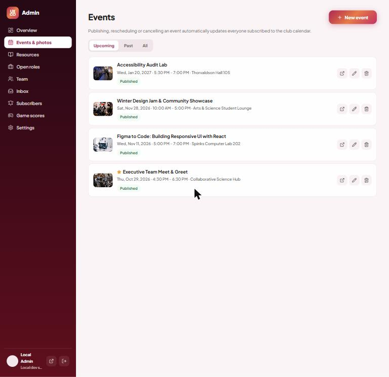
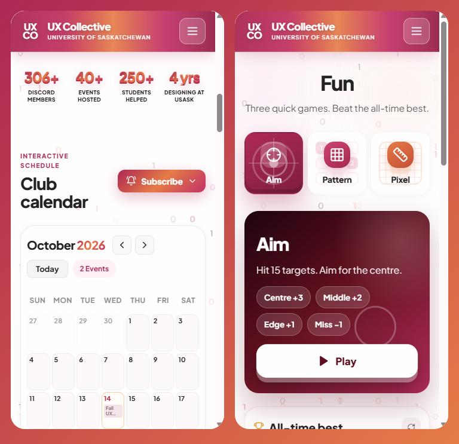

<div align="center">

# U of S UX Collective

**The website of the University of Saskatchewan's first product design club.**

Events, recaps, resources, ways to get involved, mini-games and an admin panel for the exec team, in one full-stack app.




</div>

---

## Contents

- [Features](#features)
- [Screenshots](#screenshots)
- [Tech stack](#tech-stack)
- [Getting started](#getting-started)
- [Configuration](#configuration)
- [Project structure](#project-structure)
- [API overview](#api-overview)
- [Author](#author)

---

## Features

**For students**
- **Interactive club calendar.** Event titles sit in the date cells like Google Calendar, with one-tap "Add to calendar".
- **Calendar subscription.** Subscribe once in Google, Apple or Outlook Calendar, or by email, and new or rescheduled events appear automatically.
- **Events.** A minimal list of upcoming events, a past-event archive, and detail pages with recaps, photo albums and slides.
- **Resource hub.** A beginner learning path, exec picks, and a filterable library of templates, guides and courses.
- **Get involved.** Open roles with deadlines, applications and 1-on-1 mentorship booking.
- **Gallery.** Photo albums from every event, with a full-screen viewer.
- **Fun.** Three games (Aim, Pattern, Pixel) with auto-saved scores and an all-time leaderboard.

**For the exec team (`/admin`)**
- Sign-in with a single Google account.
- **Analytics dashboard.** Visitors, page views, member growth, event engagement (views and calendar adds), game plays, resource clicks and subscriptions, over 7, 30, 90 or 365 days.
- Create and edit events, upload photo albums, write recaps.
- Manage resources, open roles, the team and homepage stats.
- An inbox for contact messages, applications and mentorship requests.
- Calendar subscriber list and game-score moderation.

**Under the hood**
- Bold but accessible motion: scroll reveals, a wheat leaf whose petals sway, and a falling binary background. Everything respects `prefers-reduced-motion`.
- Fully responsive, from 320 px phones to wide desktops.
- Spam protection (honeypots and rate limits) on every public form.
- Privacy-friendly analytics: an anonymous per-visit ID with no cookies and no personal data, stored in your own database.

---

## Screenshots

| Club calendar | Events |
|---|---|
|  |  |
| **Fun** | **Admin panel** |
|  |  |

<p align="center"></p>

---

## Tech stack

| Layer | Technology |
|---|---|
| Frontend | React 18, Vite 5, React Router 7, Lucide icons, plain CSS (custom motion system) |
| Backend | Node.js 20, Express 4, mysql2, Multer (uploads), express-rate-limit, cookie-parser |
| Auth | Google Identity Services + `google-auth-library` (ID token verified server-side), HMAC-signed session cookie |
| Calendar & email | Hand-written iCalendar (RFC 5545) feed, Nodemailer for calendar invites |
| Database | MySQL 8 (schema and demo data created automatically on startup) |
| Infrastructure | Docker Compose (MySQL, API and Vite dev server with hot reload) |

---

## Getting started

**Requirements:** [Docker Desktop](https://www.docker.com/products/docker-desktop/).

```bash
git clone <your-repo-url> UX_Collectives
cd UX_Collectives
docker compose up -d --build
```

| Service | URL |
|---|---|
| Website | http://localhost:3000 |
| Admin panel | http://localhost:3000/admin |
| API health check | http://localhost:5002/api/health |
| MySQL | `localhost:3308` (user `uxco_user`, password `uxco_password`) |

The first start creates all tables and fills them with demo events, resources, roles and team members. You can edit or replace all of it from the admin panel.

Useful commands:

```bash
docker compose logs -f backend      # follow API logs
docker compose up -d --build -V     # rebuild after changing a package.json
docker compose down                 # stop everything
docker compose down -v              # stop and wipe the database and uploaded photos
```

---

## Configuration

Create a `.env` file in the project root (next to `docker-compose.yml`). Every setting is optional for local development. [`.env.example`](.env.example) explains each one.

### Admin sign-in (one Google account)

1. Create an OAuth 2.0 Client ID (type **Web application**) in the [Google Cloud Console](https://console.cloud.google.com/apis/credentials).
2. Add your site under **Authorized JavaScript origins** (e.g. `http://localhost:3000`).
3. Add to `.env`:
   ```env
   GOOGLE_CLIENT_ID=your-client-id.apps.googleusercontent.com
   ADMIN_EMAIL=the-club-account@gmail.com
   SESSION_SECRET=a-long-random-string
   ```
4. Restart the API: `docker compose up -d backend`.

Until this is configured, the login page offers a **local dev admin** button. It is always disabled when `NODE_ENV=production`.

### Calendar invites by email (optional)

```env
SITE_URL=https://your-domain.example
SMTP_HOST=smtp.gmail.com
SMTP_PORT=587
SMTP_USER=the-club-account@gmail.com
SMTP_PASS=a-google-app-password
MAIL_FROM=UX Collective <the-club-account@gmail.com>
```

Without SMTP settings, invites are written to the API log instead of being sent. The subscribable feed (`/api/calendar.ics`) works either way. Google Calendar needs a **public** `SITE_URL` to subscribe; it can't reach `localhost`.

> The host ports for the API (5002) and MySQL (3308) avoid clashing with other local projects. Inside Docker the services use the standard ports.

---

## Project structure

Each feature lives in its own folder, with one component (and usually one stylesheet) per file.

```
UX_Collectives/
├── docker-compose.yml        # MySQL + API + frontend dev server
├── .env.example              # every configurable setting, documented
├── database/init.sql         # creates the database (tables come from the API)
├── docs/
│   ├── design/               # original design references and layout notes
│   └── screenshots/          # images used in this README
│
├── backend/                  # Express REST API
│   ├── index.js              # app setup, route mounting, error handling
│   ├── db.js                 # MySQL connection pool
│   ├── db/
│   │   ├── schema.sql        # tables (idempotent, runs on every start)
│   │   ├── migrate.js        # applies schema, adds columns, seeds empty tables
│   │   └── seed.js           # demo content
│   ├── lib/
│   │   ├── auth.js           # Google ID-token check + signed session cookie
│   │   ├── events.js         # event queries (upcoming / past / detail)
│   │   ├── games.js          # game list, score limits, leaderboard ordering
│   │   ├── ical.js           # iCalendar feed and invite builder
│   │   ├── mailer.js         # SMTP via Nodemailer
│   │   ├── subscriptions.js  # email subscribers + invite delivery
│   │   ├── uploads.js        # image uploads (Multer)
│   │   └── util.js           # validation, Saskatoon time, helpers
│   └── routes/
│       ├── public.js         # events, gallery, resources, roles, team, forms, games
│       ├── calendar.js       # .ics feed, subscribe / confirm / unsubscribe
│       ├── auth.js           # Google + dev login, session
│       └── admin.js          # everything the admin panel edits
│
└── frontend/                 # React + Vite single-page app
    ├── public/               # static images (team photos, campus shots)
    └── src/
        ├── App.jsx           # routes and page transitions
        ├── lib/              # api, dates (Saskatoon time), motion, site context, calendar feed
        ├── styles/motion.css # shared animation system
        ├── components/
        │   ├── nav/          # navbar + full-screen mobile menu
        │   ├── footer/
        │   ├── common/       # page hero, lightbox, image, binary background
        │   ├── events/       # event card, add-to-calendar, subscribe menu
        │   └── team/         # executive carousel
        └── pages/
            ├── homepage/     # hero, calendar, recaps, gallery, learn & get involved, FAQ
            ├── about/
            ├── events/       # upcoming list, past archive, event detail
            ├── resources/
            ├── involved/     # roles + application / mentorship form
            ├── gallery/
            ├── contact/
            ├── fun/          # game hub, results, leaderboard
            │   └── games/    # Aim, Pattern, Pixel + shared HUD and countdown
            └── admin/        # shell, login, shared UI
                └── sections/ # one file per admin screen
```

---

## API overview

| Method | Endpoint | Purpose |
|---|---|---|
| `GET` | `/api/events?when=upcoming\|past` | Events with photos |
| `GET` | `/api/events/:slug` | One event |
| `GET` | `/api/calendar.ics` | Subscribable calendar feed |
| `POST` | `/api/calendar/subscribe` | Email subscription (double opt-in) |
| `GET` | `/api/gallery` · `/api/resources` · `/api/opportunities` · `/api/team` | Page content |
| `GET` | `/api/site` | Homepage stats (live Discord member count, cached) |
| `POST` | `/api/contact` · `/api/applications` | Forms (rate-limited) |
| `GET` / `POST` | `/api/games/:game/leaderboard` · `/api/games/:game/scores` | Fun page |
| `POST` | `/api/track` | Anonymous analytics beacon |
| `*` | `/api/admin/*` | Admin panel and analytics (signed-in only) |

Event times are stored and shown in **Saskatoon time** (America/Regina, UTC−6, no daylight saving).

---

## Author

**Md Shahed**, Web Developer, U of S UX Collective
Last updated: October 23, 2026

Built for the [University of Saskatchewan UX Collective](https://www.instagram.com/uofs_uxcollective/), a USSU-ratified student club.
